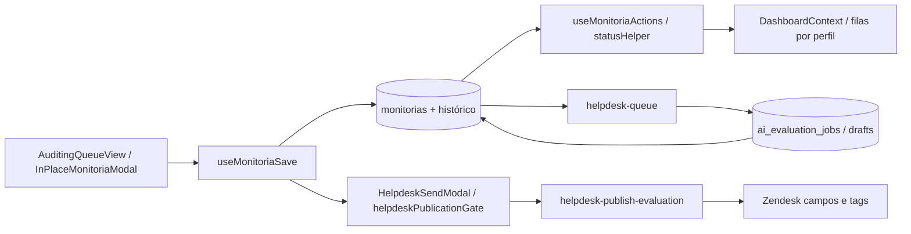

# Mapa de impacto do código

Este mapa aponta os caminhos mais sensíveis do QualiTrack e os testes que devem acompanhar mudanças. Use-o como índice inicial; confirme sempre as chamadas, permissões e migrations no código atual antes de editar.

## Fluxo de monitoria e veredito final

| Mudança em | Verificar também | Testes de referência |
|---|---|---|
| Persistência/conclusão de monitoria | `src/hooks/useMonitoriaSave.ts`, histórico e validação do formulário; políticas e triggers em `supabase/migrations/` | `useMonitoriaSave.test.tsx`, `scripts/restore-monitoria.test.mjs`, `scripts/monitoria-uniqueness.test.mjs` |
| Transições, prazos e contestação | `src/hooks/useMonitoriaActions.ts`, `src/lib/statusHelper.ts`, `src/components/PjReviewFlow.tsx`, regras SQL e cron | `useMonitoriaActions.test.tsx`, `scripts/pj-review-flow.test.mjs`, `scripts/monitoria-deadline.test.mjs` |
| Visibilidade/filas de gestores | `src/components/dashboard/DashboardContext.tsx`, `src/lib/qualityManagerQueue.ts`, dashboards por perfil e RLS | `qualityManagerQueue.test.ts`, testes de RLS e `scripts/pj-review-flow.test.mjs` |
| Ficha de ticket filho | `src/components/InPlaceMonitoriaModal.tsx`, `src/hooks/useMonitoriaSave.ts`, `src/lib/helpdesk.ts`, automação de filho | `child-automation.test.ts`, `useMonitoriaSave.test.tsx`, `scripts/child-automation.test.mjs` |
| Veredito publicado no Zendesk | `src/components/HelpdeskSendModal.tsx`, `src/lib/helpdeskPublicationGate.test.ts`, `supabase/functions/helpdesk-publish-evaluation/`, publicação automática em `helpdesk-queue/` | testes de publicação manual/automática, `scripts/final-positive-publication.test.mjs`, `scripts/final-positive-invalidation.test.mjs` |
| Relação filho/pai e análise por IA | `src/lib/helpdesk.ts`, `supabase/functions/helpdesk-queue/child-automation.ts`, `openrouter-client.ts`, `ai-targets.ts`; campos e regras nas migrations | `child-automation.test.ts`, testes de parser/contexto Zendesk e OpenRouter |
| Filas e retentativas de IA | `src/lib/aiJobs.ts`, `src/lib/aiDrafts.ts`, `src/lib/helpdeskQueue.ts`, `helpdesk-queue/index.ts`, migrations de jobs/claims/retry | testes de jobs, retentativa, claims e `scripts/positive-automation.test.mjs` |

## Regras para avaliar o impacto

1. Siga o fluxo de chamadas nos dois sentidos: quem chama a parte alterada e quem consome seus resultados.
2. Para uma mudança de estado, confira a lógica TypeScript, os triggers/RPC/RLS e as telas que filtram o estado.
3. Para uma publicação no Zendesk, confira a versão manual e a automática, inclusive tickets `closed`, tags, campos e idempotência.
4. Para tickets filhos, confira identificação do pai, critérios simples válido/inválido, respostas NA e publicação sem score.
5. Inclua testes próximos ao código e os testes de integração listados acima; não conclua impacto só pelo nome do arquivo.

## Ferramenta de grafo recomendada

Graft é a primeira escolha para rastrear dependências e impacto entre símbolos/arquivos TypeScript. Gere o grafo estrutural local (sem `--deep`, que adiciona resumos por modelo) e consulte chamadores/dependências antes de alterar um fluxo. Mantenha este mapa e `docs/architecture/`, `docs/flows/` e `docs/specs/` como contexto de regras de negócio, banco e integrações externas.

Graphify é uma alternativa melhor quando a pergunta principal cruza muitos formatos de documentação, SQL e artefatos além do código. Não use os dois como fontes concorrentes: escolha um grafo principal e valide cada ligação no código, porque relação inferida não prova comportamento em execução.

Na primeira configuração do Graft, confira o `--dry-run`; não instale hooks automaticamente sem revisar os arquivos que serão alterados. O grafo regenerável não deve conter `.env`, credenciais ou dumps de dados.
