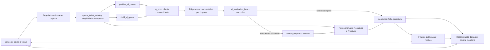

# Auditoria de monitorias QWP ↔ Zendesk — 15/10/2026

> Para a pergunta específica **“quais tickets receberam nota interna no Zendesk mas não têm monitoria salva no QWP, e por quê?”**, consulte a [auditoria direcionada de 16/10](./2026-10-16-notas-internas-sem-monitoria.md). Ela confere os comentários privados diretamente e substitui a inferência por tag usada no recorte anterior.

## Escopo e corte

Consultas de leitura no Zendesk e no Supabase de produção, sem alteração de tickets, fichas ou filas. Tickets criados de **01/10/2026 00h00 a 17/10/2026 00h00, horário de São Paulo** (`2026-10-01T03:00:00Z` a `2026-10-17T03:00:00Z`), com corte da exportação em **15/10/2026 17h34**. O dia 16 ainda não ocorreu. Os números das filas e de produção foram conferidos entre 17h34 e 17h38; podem variar porque os workers continuam ativos.

Usei a Search Export API do Zendesk para os IDs e datas dos tickets, comparei os IDs com todas as versões de `monitorias`, `queue_ticket_catalog`, filas e rascunhos do QWP e consultei diretamente os tickets e históricos de comentários referenciados pelo QWP. O Zendesk pode atrasar a indexação da busca; o resultado é um retrato do horário de corte, não um fechamento definitivo do mês. A [Search API](https://developer.zendesk.com/api-reference/ticketing/ticket-management/search/) documenta a exportação por cursor e o atraso de indexação.

## Cobertura dos tickets criados no período

| Medida | Tickets | Leitura correta |
|---|---:|---|
| Tickets criados no Zendesk | 9.217 | Universo do período até 15/10 17h34. |
| Com monitoria ativa no QWP | 635 | 6,9% do universo; há 671 versões de ficha, incluindo 36 versões inativas. |
| Sem monitoria no QWP | 8.582 | Não são automaticamente falhas: 7.038 nem estão no catálogo de filas do QWP. |
| Presentes no catálogo do QWP | 2.179 | As filas podem se sobrepor; 20 tickets estão em Positivas e Proativas. |
| Catalogados ainda sem monitoria | 1.544 | Demandam classificação por fila e estado. |

| Criação em São Paulo | Tickets | Com monitoria ativa |
|---|---:|---:|
| 01/10 | 814 | 12 |
| 02/10 | 796 | 29 |
| 03/10 | 204 | 3 |
| 04/10 | 72 | 2 |
| 05/10 | 955 | 12 |
| 06/10 | 915 | 29 |
| 07/10 | 857 | 94 |
| 08/10 | 881 | 91 |
| 09/10 | 765 | 70 |
| 10/10 | 233 | 22 |
| 11/10 | 58 | 0 |
| 12/10 | 85 | 4 |
| 13/10 | 814 | 69 |
| 14/10 | 899 | 117 |
| 15/10 (até 17h34) | 869 | 81 |
| 16/10 | — | Dia futuro no horário do corte. |

| Fila do catálogo | Catalogados | Com monitoria | Sem monitoria | Interpretação |
|---|---:|---:|---:|---|
| CSAT Negativas | 57 | 57 | 0 | Cobertura completa dos tickets **catalogados**. |
| CSAT Positivas | 929 | 219 | 710 | 474 aguardam revisão humana; 86 estão bloqueados; 149 têm snapshot no catálogo, mas nenhum job, rascunho ou item na fila automática; 1 tem rascunho manual. |
| Chamados filhos | 550 | 318 | 232 | 214 pendentes, 5 para revisão, 1 bloqueado; 12 sem item na fila automática, dos quais 8 ainda abertos e sem snapshot de avaliação. |
| Proativas | 663 | 48 | 615 | Fila de seleção/amostragem manual, portanto não há regra de avaliar todos. Não somar seus números aos das outras filas. |

Os **149 positivos sem qualquer pipeline** têm snapshots válidos no catálogo, verificados entre 01 e 08/10. Eles não serão resolvidos apenas esperando o worker: não há linha em `positive_ai_queue` para ser reclamada. A hipótese mais provável é captura anterior à ativação da automação, pois o trigger só enfileira quando a configuração está habilitada; confirmar essa sequência antes do reprocessamento.

No Zendesk, 63 tickets do período têm CSAT `bad`: 57 constam como monitorados e catalogados no QWP; **6 não constam nem no catálogo nem nas monitorias** (IDs `183287`, `183472`, `183577`, `183904`, `184379`, `185588`). É necessário conferir se atendem aos filtros da view de Negativas antes de classificá-los como falha de captura. Dos 1.225 tickets com CSAT `good`, 219 têm monitoria; 295 ainda não estão catalogados como positivos. A elegibilidade depende das views e regras de operação, não só da nota da pesquisa.

Dos 526 tickets do período com tag `qwp_filho_avaliado`, 312 têm monitoria no QWP e **214 não têm**. Todos os 214 estão no pipeline: 208 `pending`, 5 `review_required`, 1 `blocked`. A tag pode representar um parecer antigo e, sozinha, não prova que a nova ficha foi salva.

Fora do intervalo de criação solicitado, a busca global pela mesma tag encontrou **25 tickets com jobs antigos de três critérios concluídos em 30/09**, sem ficha, rascunho ou nova fila. A recuperação da PR #68 abrangeu jobs de **01 a 06/10**; arquivou e recolocou **229** tickets no pipeline, dos quais **211** ainda estavam pendentes às 17h36. Os 25 de 30/09 precisam de recuperação separada e idempotente após revisão do histórico.

## Fichas salvas versus publicadas

Às 17h36, o QWP tinha **698 versões de monitoria** em **662 tickets**; **660** eram fichas ativas. Consultei os 662 IDs diretamente no Zendesk: **662/662 tickets encontrados**. Conferi 3.588 comentários: **297/297 IDs de comentário registrados como enviados** em `helpdesk_submissions` existem no Zendesk. As **310/310** fichas ativas e concluídas de filhos com nota ≥75 tinham a tag esperada no ticket.

Há **438 monitorias ativas distintas com envio registrado**: 114 apenas em `helpdesk_submissions`, 183 nessa tabela e em `positive_auto_publications`, e 141 em `child_auto_publications`. Outras **162 fichas manuais de filhos** sem recibo estruturado têm marcador da monitoria específica confirmado nos comentários do Zendesk. Assim, há **600 fichas ativas com evidência direta de publicação da ficha atual**. A contagem é por monitoria, eliminando o mesmo envio contabilizado em duas tabelas.

Para os tickets **criados no período**, 671 versões foram salvas no QWP, sendo 635 ativas; **422** fichas ativas têm envio registrado e **162** fichas manuais de filhos têm marcador específico confirmado. Portanto, **584/635 fichas ativas** desse grupo têm evidência direta no Zendesk. As demais 51 exigem separar revisão ainda pendente, publicação pulada e registro antigo sem recibo.

Exceções verificadas:

- **7 fichas automáticas de filhos** concluídas e salvas têm publicação `skipped` porque o ticket está fechado ou indisponível. A tag existe, mas o comentário da ficha atual não; são os tickets `175783`, `176249`, `176488`, `176528`, `176549`, `176660`, `176688`.
- **9 fichas automáticas positivas** foram salvas e tiveram publicação `skipped` porque o ticket está fechado: `177386`, `177420`, `177434`, `177466`, `177531`, `177541`, `177551`, `177571`, `177604`.
- **17 fichas ordinárias concluídas** não têm recibo QWP de envio. Em 4 tickets há um comentário genérico da macro de Qualidade, mas não há vínculo inequívoco com a ficha atual; em 13 não encontrei essa macro. Os tickets `179882` e `184957` ainda estavam `solved` na consulta e merecem conferência prioritária antes de qualquer envio.
- **2 tentativas manuais** constam como `failed` com resultado incerto (`173036` e `180231`). É necessário verificar o histórico antes de tentar novamente para evitar comentário duplicado.

Os recibos não têm referência a monitoria inexistente, ticket divergente ou ID de comentário vazio. Não há dois registros ativos para o mesmo ticket nem ficha ativa fora do catálogo.

As listas de IDs para triagem estão em [`2026-10-15-monitoria-action-ids.json`](./2026-10-15-monitoria-action-ids.json). Elas registram o recorte desta auditoria e devem ser revalidadas antes de qualquer reprocessamento, porque as filas continuam andando.

## Vazão e limite de carga

Na janela de 24 horas encerrada às **17h38**: 192 jobs de IA foram iniciados, dos quais **161 automáticos** (97 positivos e 64 filhos). A média automática foi **0,11 job/min**; na última hora, **31 jobs** (**0,52/min**). O pico automático observado foi **2/min** e o pico de todos os jobs, incluindo os manuais, **3/min**. A duração média dos jobs concluídos foi **54,7 s**, percentil 95 de **69,1 s**. Foram criadas 104 fichas em 24 horas, 56 por automação.

No corte do funil dos 161 jobs automáticos: **79** já se ligavam a uma ficha salva, **81** estavam em `review_required` e **1** em avaliação. Os 81 casos para revisão não devem ser contados como falha de persistência ou publicação: a regra de negócio impede conclusão automática sem critérios suficientes. Entre as **56 fichas automáticas criadas nas últimas 24 horas**, **47** já tinham envio registrado; as janelas de criação e início do job são diferentes e não devem ser divididas entre si como taxa de conversão.

Os seis crons examinados tiveram **1.440 execuções `succeeded` cada** nas últimas 24 horas. Antes da migração proposta, `qwp-positive-ai` e `qwp-child-ai` chamam seus workers a cada minuto, podendo executar simultaneamente. A migração `20261015000003_automation_dispatch_rate_limit.sql`, preparada localmente e **ainda não aplicada em produção**, alterna os dois agendamentos e usa um bloqueio atômico compartilhado: **máximo de um disparo automático de avaliação em qualquer janela móvel de 60 segundos**, até 30 oportunidades por hora para cada fila. O limite atua antes da chamada à Edge Function; não restringe avaliação manual, retentativa de job já iniciado nem publicação. Em momentos de fila vazia, uma oportunidade pode terminar sem criar job.

O status `succeeded` do cron confirma a execução do disparador SQL, não a conclusão da requisição HTTP nem ausência de pressão no banco. Esta auditoria não mediu CPU, I/O, latência de queries ou consumo das Edge Functions; esses sinais devem compor o painel de saúde antes de ajustar a capacidade acima de 1/min.

## Arquitetura operacional e equilíbrio

| Etapa | Componente atual | Persistência/controle | Saída verificável |
|---|---|---|---|
| Captura | `helpdesk-queue` lê views e tickets Zendesk | `queue_ticket_catalog` guarda origem, ID e snapshot | Ticket elegível registrado ou motivo de exclusão. |
| Agendamento | `pg_cron` chama workers de positivas e filhos | `positive_ai_queue`, `child_ai_queue`, bloqueio compartilhado proposto | Um item reservado por chamada e limite global de disparo. |
| Avaliação | Edge Function chama IA e valida ficha | `ai_evaluation_jobs`, retentativas, `ai_evaluation_drafts` | Ficha pronta, revisão humana, bloqueio ou erro explícito. |
| Persistência | Conclusão automática ou formulário manual | `monitorias`, uma versão ativa por ticket | ID da ficha, status e histórico. |
| Publicação | Fluxo manual e workers automáticos | `helpdesk_submissions`, `positive_auto_publications`, `child_auto_publications` | ID de comentário/marker ou `skipped` justificado. |
| Reconciliação | Consulta de auditoria sob demanda hoje | Inventário incremental e rotina diária propostos | Lacunas por coorte e idade, com alerta. |

O desenho de operação saudável deve medir **coortes**, não apenas totais: (1) ticket elegível e catalogado; (2) item de fila; (3) job iniciado; (4) ficha salva ou revisão humana registrada; (5) ficha concluída publicável; (6) comentário específico confirmado no Zendesk ou exceção `skipped` com motivo. A referência de cada etapa deve ser `ticket_id` e `monitoria_id`; a publicação manual de filhos precisa de recibo estruturado para deixar de depender de busca textual no comentário.

Para cada dia de entrada, o painel deve mostrar contagens e tempos entre etapas: **captura → fila**, **fila → início da IA**, **IA → ficha ou revisão**, **ficha concluída → comentário confirmado**. O denominador da taxa de persistência automática deve excluir jobs ainda em execução e mostrar `review_required`/`blocked` como saídas separadas; o da taxa de publicação deve considerar apenas fichas concluídas e publicáveis, com tickets fechados contabilizados como exceção explícita. O objetivo de equilíbrio é **100% dos itens explicados por um estado final ou pendência visível**, sem exigir que os totais brutos de jobs, fichas e comentários sejam iguais.

| Controle recomendado | Meta operacional inicial | Motivo |
|---|---|---|
| Disparos automáticos agendados | ≤1 por 60 s, somando positivas e filhos | Reduz concorrência de Edge, Zendesk e banco; limite já preparado na migração. |
| Ficha concluída e publicável sem comentário | Alerta após 15 min; exceção explícita para ticket fechado | Separa atraso transitório de perda de publicação. |
| Ticket elegível catalogado sem fila/monitoria/rascunho | Zero após reconciliação diária | Detecta os 149 positivos antigos fora do pipeline. |
| Fila de revisão humana | Medir idade do item mais antigo e entradas/saídas por dia | Os 475 positivos `review_required` não são resolvidos por mais chamadas à IA. |
| Cobertura por origem | Denominadores separados para Negativas, Positivas, Filhos e Proativas | Não confunde amostragem manual com automação ou todos os tickets Zendesk. |

Uma pequena tabela de inventário incremental (`ticket_id`, data, status, nota, origem, `updated_at`, elegibilidade, último sync) permitiria cobertura diária sem exportar todos os tickets sob demanda. A reconciliação deve comparar esse inventário com as filas, `monitorias` e os IDs de comentário, com alertas para lacunas persistentes. Antes de reprocessar histórico, revisar os 149 positivos sem pipeline, os 6 CSAT ruins fora da view, os filhos legados e as publicações com resultado incerto. Reprocessamento deve manter idempotência por ticket e preservar jobs e fichas existentes.

## Verificação da alteração local

Branch `perf/automation-rate-limit-20261015`. A migração de limite compartilhado, teste de bloqueio/privilegios e documentação foram preparados localmente. `npm.cmd run lint`, `npm.cmd test` (**108 arquivos, 518 testes**) e `npm.cmd run test:database` (**102 testes**) passaram. A migração ainda requer aprovação final para aplicação em produção, conforme `AGENTS.md`.
